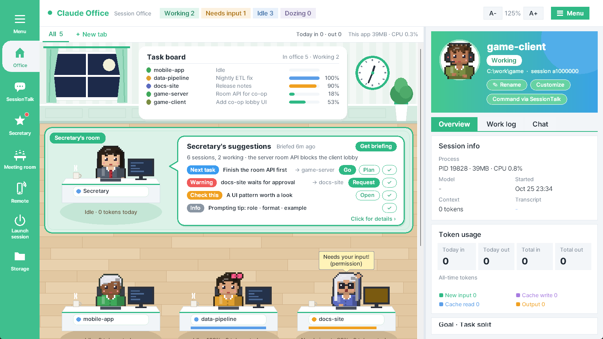
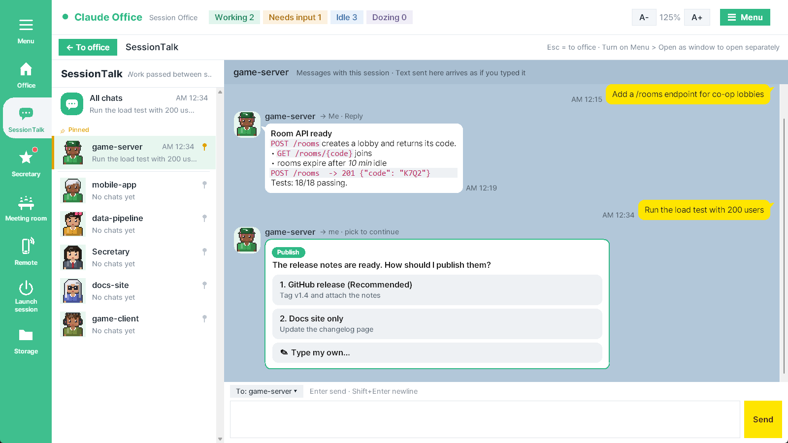
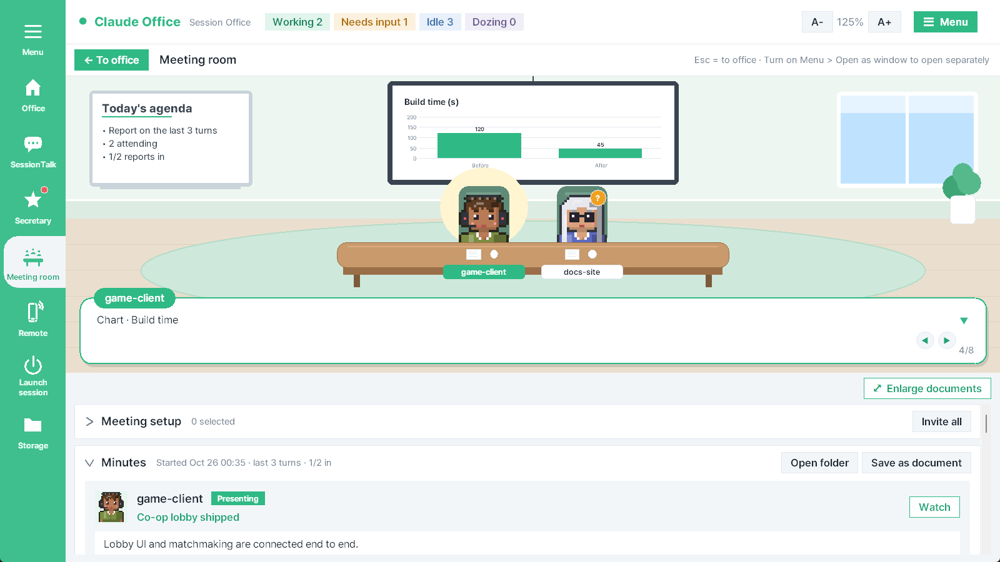
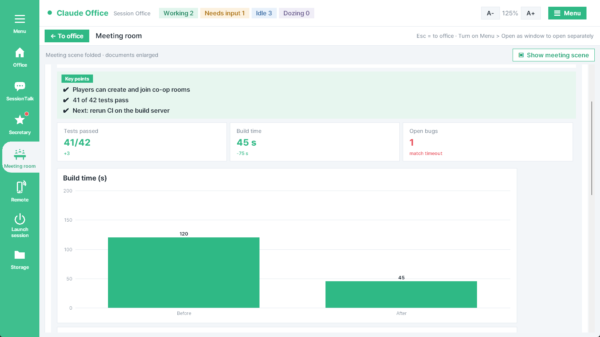
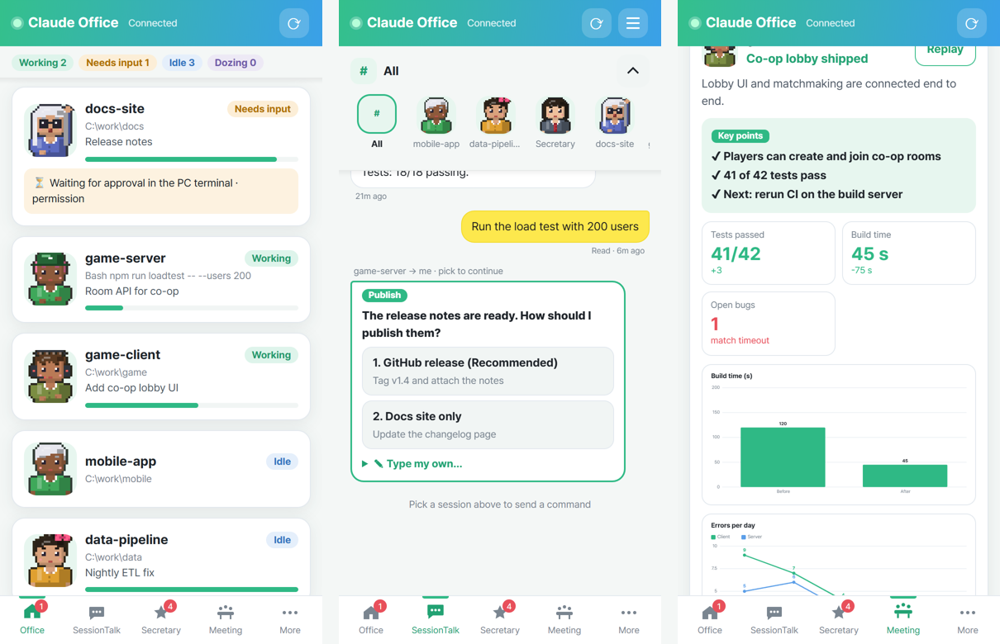
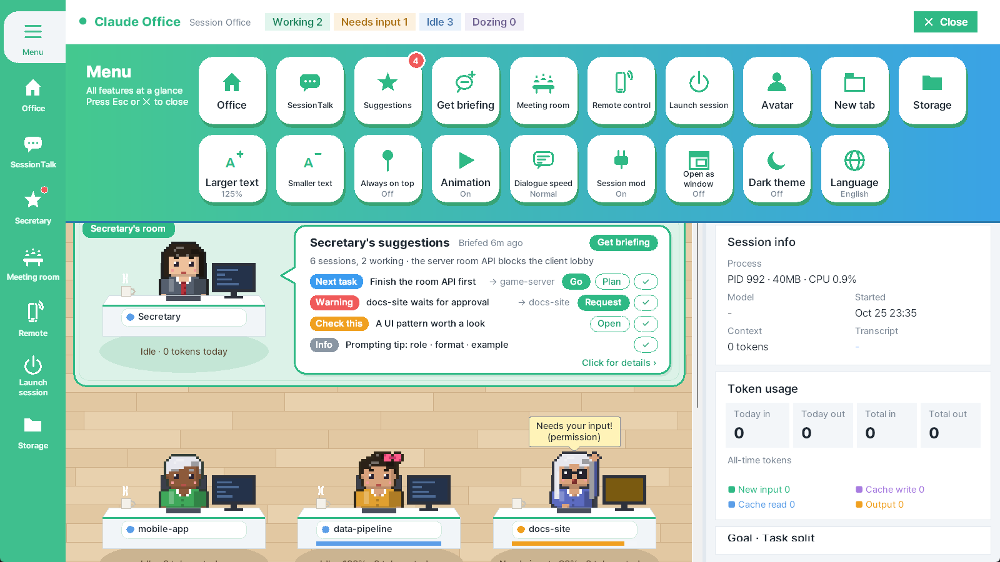
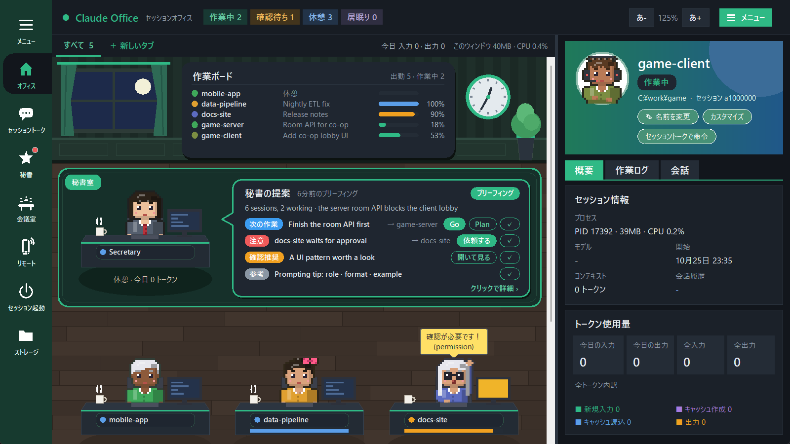
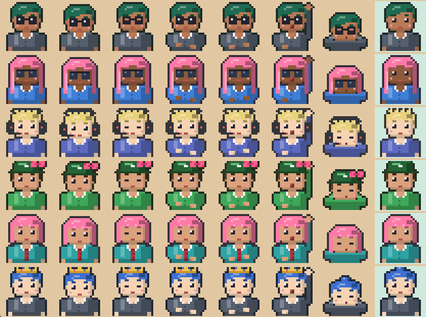
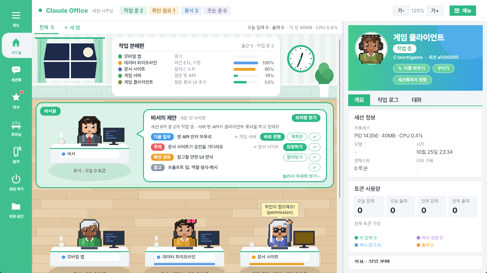

# Claude Office · 세션 사무실

**See every Claude Code session on your PC as a pixel-art office — and work with them like a chat app, from your PC or your phone.**

A Windows desktop app (Python + tkinter, no extra packages) that turns your running
[Claude Code](https://claude.com/claude-code) CLI sessions into office workers: typing while they work, raising a hand
when they need you, dozing when idle. Talk to any session in a KakaoTalk-style **SessionTalk** that mirrors the CLI
(progress line, choice questions, images), hold **meetings** where sessions present their work with charts and
captures, get next-step suggestions from a **secretary**, and control it all from a **phone app**.

[English](#english) · [한국어](#한국어)



---

## English

### Contents
[Features](#features) · [Requirements](#requirements) · [Install & first run](#install--first-run) ·
[How to use](#how-to-use) · [Phone remote control](#phone-remote-control) · [session-panel mod](#session-panel-mod) ·
[Remote control security](#remote-control-security) · [Cost & privacy](#cost--privacy) · [Troubleshooting](#troubleshooting) ·
[Files it reads and writes](#files-it-reads-and-writes) · [Forks & contributing](#forks--contributing)

### Features
**Office**
- One desk per running Claude Code session: status (working / needs input / idle / dozing), the tool it is using in a
  speech bubble, progress bar and today's tokens. Paper planes fly when sessions message each other.
- **Task board** with every session's goal and progress, the **secretary's room**, and a side panel per session:
  overview (process, model, context, token breakdown), work log and the Q&A of your requests.
- Tabs to group sessions (drag a desk onto a tab), drag desks to reorder, **avatars** (hair, colors, outfits, accessories).
- Empty leftover sessions (e.g. a terminal that only got a mod reload notice) and stale status files are cleaned up
  automatically.

**SessionTalk** (KakaoTalk-style chat that feels like the CLI)
- A room per session plus *All chats*. Type to send a command to the session as if you typed it in its terminal.
- Each room shows the last **20 exchanges**, including ones typed straight into the terminal, rendered as
  **markdown** (bold, italic, code, code blocks, headings, lists, quotes, links).
- While a session works you see the CLI's line: **`✻ Working… (6m 2s · ↓ 26.8k tokens)`** and the tool it is running.
- When Claude asks you to choose (**AskUserQuestion**), the question appears as a card with buttons. Pick one
  (or several, or type your own) and the session continues exactly as if you had answered in the terminal.
- Ask for screenshots ("send me a capture of the result") and the session saves them where SessionTalk can show
  them: **images appear in the chat** (click to enlarge). Images older than about 10 turns are folded into a
  "🖼 click to view" line to save memory; the image folder is trimmed only if it grows past 300 MB.
- **Pin** important sessions to the top of the list (gold bar). Opens instantly: the latest 50 messages first,
  *↑ show earlier messages* for more.



**Secretary**
- A dedicated Claude session (offered on first run) that looks over the other sessions only when you press
  **Get briefing**, then suggests next steps. Each suggestion has buttons that send the task to the right session.
- Suggestions you sent show their **outcome** (sent / in progress / result in / session off) with the start of the
  answer; *Show checked too* keeps finished items, and **Open in SessionTalk** shows the full reply.

**Meeting room**
- Invite sessions and pick the last 1/3/5/10 turns. Each session writes a report of what it did (done / partial /
  not done, files, next steps) and captures its results with [`assets/capture.ps1`](assets/capture.ps1).
- Sessions sit around a table; when a report arrives the session raises a hand and **presents** it in a typed-out
  dialogue box with its captures on the projector (click to view large; ◀ ▶ or click to page).
- **Report style** in *Meeting setup*: **Brief** (fewer tokens) or **Detailed** — sessions also write key points,
  key figures and chart data and mark the important part of each capture, so the meeting shows a **figures board**,
  **bar / line / pie charts** and **zoomed-in captures**, like a report at work. Charts are drawn by the app from the
  data (no image files needed).
- **Minutes** keep every report as a card (charts click to enlarge) and **Save as document** writes one HTML file.
  **Enlarge documents** folds the scene so setup and minutes use the whole window.

| | |
|---|---|
|  |  |

**Phone app (remote control)**
- A phone web app (PWA) with the office, SessionTalk (CLI line, choice cards, images, pins), secretary, meeting room
  (presentation, charts, captures) and session launch / resume, plus notifications when a session needs approval.
- Connects through a temporary Cloudflare tunnel the PC opens outward — no router setup. Details below.



**Everything else**
- Launch a new session in a folder or resume a closed one in a new terminal.
- Game-style menu, light / **dark theme**, **Korean / English / Japanese / Chinese**, zoom 100–200 %, dialogue
  typing speed, smooth animations (can be turned off), *Open as window* for separate windows.
- Light on resources (~60 MB RAM, a few % of one CPU core).

| | |
|---|---|
|  |  |



### Requirements
- Windows 10/11
- Python 3.10+ with tkinter (the python.org installer or `uv python install 3.11` both include it)
- Claude Code CLI (`claude`) installed and on `PATH`
- For the phone app only: `cloudflared` (the app downloads it for you) and a phone browser

### Install & first run
```bat
git clone https://github.com/airyanrip/claude-office.git
cd claude-office
pythonw claude_office.pyw
```
or double-click `run.bat`. On first run the app:
1. offers to create a **secretary** session (and installs the `secretary` skill if missing), and
2. offers to install the **session-panel mod** — say yes, it is what delivers your SessionTalk / phone commands,
   choice answers and progress reports (see [session-panel mod](#session-panel-mod)).

Claude Code sessions started **after** the mod is installed pick it up. Settings live in
`%LOCALAPPDATA%\ClaudeOffice\settings.json`.

### How to use
- **Office** – click a character to see its session in the side panel. Drag desks to reorder, onto a tab to group.
  *Rename* / *Customize* / *Command via SessionTalk* are on the panel header.
- **SessionTalk** (sidebar or menu) – pick a room, type, **Enter** to send (Shift+Enter for a new line).
  Click the pin next to a session to keep it on top. When a choice card appears, click an option (or *Type my own…*);
  with several questions or multi-select, press *Send answer*. To get images, just ask ("send the capture too").
- **Secretary** – press **Get briefing**; when suggestions arrive, press a choice button to send that task.
  Tick *Show checked too* to see the outcome of tasks you already sent.
- **Meeting room** – open *Meeting setup*, pick sessions, the range (last N turns) and the report style, then
  **Start meeting**. Reports are presented as they arrive; *Watch* replays one. *Enlarge documents* for a big view,
  *Save as document* for an HTML file. *End meeting* when done.
- **☰ Menu** – everything in one place: SessionTalk, suggestions, briefing, meeting room, remote control, launch
  session, avatar, new tab, storage (folder sizes), text size, always on top, animation, dialogue speed,
  **Session mod** (install / update), open as window, dark theme, language.

### Phone remote control
1. **☰ Menu → Remote control → Turn on remote.** The first time, press *Download* to get `cloudflared`
   (Cloudflare's official build, ~55 MB) into the app's data folder.
2. Connect a phone, either:
   - **QR**: *Connect a phone (show QR)* and scan it — a one-time code for one device, valid 10 minutes; or
   - **Address + password**: set a password under *Password lock*, press **Copy address** and open it on the phone,
     then enter the password. Check that the *PC code* on the phone matches the one on the PC.
3. In the phone browser choose **Add to Home Screen** to use it like an app, and allow notifications in *More* to be
   told when a session needs approval. On iPhone, notifications work only when the app is opened from the Home Screen (Safari → Share →
   Add to Home Screen).
4. **Open phone screen** shows the same app in a phone-sized window on the PC (local only) — handy to try it out.

The phone app itself is a static page served from this repository's GitHub Pages
(`https://airyanrip.github.io/claude-office/m/`); the tunnel only carries the API. Approving tool permissions still
happens in the PC terminal. Turn Remote off when you are not using it.

### session-panel mod
[`mod/session-panel`](mod/session-panel) is a Claude Code mod that every session loads. It writes progress reports
and inter-session messages, delivers the commands you send from SessionTalk or the phone, and (0.3+) lets SessionTalk
answer Claude's choice questions. The app installs and updates it for you (**☰ Menu → Session mod**): it copies the
folder to `%USERPROFILE%\.claude\mods\session-panel` and adds that folder to `env.CLAUDE_CODE_PLUGIN_DIRS` in
`%USERPROFILE%\.claude\settings.json` (other settings are kept; the original is saved as `settings.json.office-backup`).
To do it by hand, do those two steps. Without the mod the office still shows sessions, status, tokens and logs, but
commands are not delivered, the task board stays empty and choice cards do not appear.

### Remote control security
- **Nothing is reachable without a key.** Every API call needs a per-device key; the PC keeps only its SHA-256 hash.
  A valid key always works; wrong keys are slowed down per IP.
- **Keys are handed out only two ways:** a QR with a *one-time* code (one device, 10 minutes), or **Copy address** +
  the **password** you set (PBKDF2-hashed; 5 wrong tries per IP in 15 minutes or 20 in total per hour lock password
  login and notify you). A copied address alone grants nothing.
- **The phone checks it is talking to your PC.** The PC has its own signing key; links carry the public half. The phone
  sends its key or password only to an address that signs a fresh challenge for that exact address and ignores
  unsigned addresses on the ntfy channel, so a leaked channel name or a fake server gets nothing.
- The server listens on 127.0.0.1 only, the tunnel is outbound, push goes only to known push services, and images
  are served only if a session put them in SessionTalk. Changing the password can disconnect all devices; devices can
  also be disconnected one by one.

### Cost & privacy
- The app makes no Anthropic API calls of its own. The only cost is your normal Claude Code usage: commands you send,
  briefings, meeting reports (Detailed reports use more tokens, mostly to look at captures).
- Without Remote, nothing leaves your PC. With Remote on, it uses free services that need no account: a Cloudflare
  quick tunnel, an ntfy.sh channel (only the current tunnel address, signed), web push, GitHub Pages and the
  Pretendard font from jsDelivr.

### Troubleshooting
- **Commands from SessionTalk / phone don't arrive, no choice cards, empty task board** – install or update the mod
  (**☰ Menu → Session mod**) and start a new Claude Code session (or `/resume` the old one in a new terminal).
- **"Needs input" never clears** – the session is waiting for a permission prompt in its terminal; approve it there.
- **No images in SessionTalk** – the session must save a PNG and write `` on its own line;
  asking for a "capture" or "screenshot" adds that instruction automatically.
- **Phone can't connect** – Remote must be *On* on the PC; for address + password a password must be set; if the
  phone shows a different *PC code* it is not your PC. The phone page needs GitHub Pages to be enabled for the repo
  you use (see below).
- **Remote won't turn on** – press *Download* for `cloudflared`, or put `cloudflared.exe` on `PATH`.

### Files it reads and writes
Reads: `~/.claude/sessions/*.json`, `~/.claude/projects/**/*.jsonl` (transcripts), `~/.claude/session-collab/*`
(mod files). Writes: its settings and token cache (`%LOCALAPPDATA%\ClaudeOffice`), session names
(`session-collab/names.json`), commands you send (`out-office-user.json`), choice answers (`answer-<session>.json`),
meeting state and documents (`session-collab/meeting/`), and deletes only empty transcripts with no messages and stale
`peer-*.json` status files of ended sessions. Session images live in `session-collab/talk/`.

### Forks & contributing
- **Phone app for a fork**: enable GitHub Pages (Settings → Pages → *Deploy from a branch* → `main` / `/docs`), then set
  `"remote_app": "https://<you>.github.io/<repo>/m/"` in `%LOCALAPPDATA%\ClaudeOffice\settings.json`.
- Your settings, keys and transcripts live outside the repository and `.gitignore` blocks those file names. To check
  every commit for personal data and secrets run once `git config core.hooksPath .githooks`. The hook
  ([`tools/check_private.py`](tools/check_private.py)) stops commits containing your Windows user name or home path,
  a real e-mail, the Remote keys on this PC, common API tokens, or words listed in a local `.private-words` file.
  `python tools/check_private.py --all` scans the whole tree.
- Mod tests: `claude plugin test .` inside `mod/session-panel` (with the type stubs of an installed copy).

---

## 한국어

### 목차
[기능](#기능) · [준비물](#준비물) · [설치와 첫 실행](#설치와-첫-실행) · [사용법](#사용법) · [휴대폰 원격 조종](#휴대폰-원격-조종) ·
[session-panel mod](#session-panel-mod-1) · [원격 조종 보안](#원격-조종-보안) · [비용과 개인 정보](#비용과-개인-정보) ·
[문제 해결](#문제-해결) · [읽고 쓰는 파일](#읽고-쓰는-파일) · [포크와 기여](#포크와-기여)

### 기능
**사무실**
- 켜져 있는 Claude Code 세션마다 책상 하나. 작업 중이면 타자를 치고, 확인이 필요하면 손을 들고, 쉬면 졸아요.
  지금 쓰는 도구가 말풍선으로, 진행도와 오늘 토큰이 책상 아래에 보이고, 세션끼리 메시지를 보내면 종이비행기가 날아가요.
- 세션들의 목표·진행도를 모은 **작업 분배판**, **비서실**, 세션마다 개요(프로세스·모델·컨텍스트·토큰)·작업 로그·대화를 보는 오른쪽 패널.
- 탭으로 세션 묶기(책상을 탭 위로 끌기), 끌어서 자리 바꾸기, **아바타 꾸미기**.
- 대화가 하나도 없는 빈 세션 기록(예: mod 다시 불러오기 알림만 적힌 터미널)과 끝난 세션의 상태 파일은 자동으로 정리해요.

**세션톡** (CLI를 그대로 옮긴 듯한 카톡 풍 대화)
- 세션마다 방 하나 + *전체 대화*. 입력하면 그 세션 터미널에 직접 친 것처럼 들어가요.
- 방마다 터미널에서 직접 나눈 대화까지 **최근 20개**가 보이고, Claude Code처럼 **마크다운**(굵게·기울임·코드·코드 블록·제목·목록·인용·링크)으로 보여요.
- 세션이 일하는 동안은 CLI 아래 줄처럼 **`✻ 작업 중… (6m 2s · ↓ 26.8k tokens)`**와 지금 쓰는 도구가 보여요.
- Claude가 고르라고 물으면(**AskUserQuestion**) 질문이 버튼 카드로 떠요. 고르면(여럿 고르기·직접 입력도) 터미널에서 답한 것과 똑같이 이어서 진행해요.
- "캡처 화면도 보내줘"처럼 사진을 부탁하면 세션이 세션톡이 보여 줄 수 있는 곳에 저장해 **대화에 사진이 떠요**(누르면 크게).
  약 10턴보다 오래된 사진은 "🖼 눌러서 보기"로 접어 메모리를 아끼고, 사진 폴더는 300MB를 넘을 때만 오래된 것부터 지워요.
- 중요한 세션은 **핀**으로 목록 위에 고정(금색 표시). 열 때 렉이 없게 최근 50개만 먼저 그리고 *↑ 이전 대화 더 보기*로 더 봐요.

**비서**
- 다른 세션들을 살펴보고 다음 할 일을 제안하는 전용 세션(처음 실행할 때 만들지 물어봐요). **[브리핑 받기]**를 누를 때만 일하고,
  제안의 선택지 버튼을 누르면 그 일이 해당 세션에 바로 요청돼요.
- 맡긴 일은 **진행 결과**(요청 보냄·진행 중·결과 도착·세션 꺼짐)와 답변 앞부분이 붙어요. *확인한 것도 보기*로 지난 제안도 보고,
  **[세션톡에서 자세히 보기]**로 전체 답을 봐요.

**회의실**
- 세션을 초대하고 최근 1·3·5·10턴을 고르면, 세션마다 맡은 일의 결과(완료·일부·못 함, 파일, 남은 일)를 보고서로 쓰고
  [`assets/capture.ps1`](assets/capture.ps1)로 결과 화면을 캡처해요.
- 초대한 세션은 탁자에 둘러앉고, 보고서가 오면 손을 든 뒤 타이핑되듯 나오는 대사로 **발표**해요. 캡처는 발표 스크린에 떠요(누르면 크게).
- 회의 준비의 **보고 방식**: **간단**(토큰 절약) 또는 **상세** — 세션이 핵심 줄·핵심 수치·그래프 데이터를 더 적고 캡처의 중요한 부분을
  표시해, 회의에서 **수치판**, **막대·꺾은선·원 그래프**, **확대한 캡처**로 회사 보고처럼 보여 줘요. 그래프는 데이터로 받아 앱이 그려요.
- **회의록**에 보고서가 카드로 남고(그래프는 눌러서 크게), **[자료로 저장]**으로 HTML 한 장이 돼요.
  **[문서 크게 보기]**로 장면을 접고 회의 준비·회의록을 창 전체로 봐요.

**휴대폰 앱(원격 조종)**
- 사무실, 세션톡(진행 중 줄·선택지 카드·사진·고정), 비서, 회의실(발표·그래프·캡처), 세션 켜기·다시 켜기를 휴대폰 웹앱(PWA)으로.
  세션이 확인을 기다리면 알림도 와요.
- PC가 Cloudflare 임시 터널을 바깥으로 열어 연결해요(공유기 설정 없음). 자세한 건 아래에.

**그 밖에**
- 새 세션 시작, 꺼진 세션 이어서 켜기(새 터미널 창).
- 게임식 메뉴, 밝은/**다크 테마**, **한국어·영어·일본어·중국어**, 글자 크기 100~200%, 대사 속도, 부드러운 움직임(끌 수 있음), *창으로 열기*.
- 가벼워요(메모리 약 60MB, CPU 한 코어의 몇 %).



### 준비물
- Windows 10/11
- tkinter가 들어 있는 Python 3.10 이상 (python.org 설치본, `uv python install 3.11` 모두 OK)
- Claude Code CLI(`claude`)가 설치되어 `PATH`에 있어야 해요
- 휴대폰 앱을 쓸 때만: `cloudflared`(앱이 받아 줘요)와 휴대폰 브라우저

### 설치와 첫 실행
```bat
git clone https://github.com/airyanrip/claude-office.git
cd claude-office
pythonw claude_office.pyw
```
또는 `run.bat` 더블클릭. 처음 실행하면:
1. **비서** 세션을 만들지 묻고(필요하면 `secretary` 스킬도 설치),
2. **session-panel mod** 설치를 권해요 — 꼭 설치하세요. 세션톡·휴대폰 명령, 선택지 답, 진행 보고가 이 mod로 오가요.

mod를 설치한 **뒤에** 켜는 Claude Code 세션부터 적용돼요. 설정은 `%LOCALAPPDATA%\ClaudeOffice\settings.json`에 저장돼요.

### 사용법
- **사무실** – 캐릭터를 누르면 오른쪽 패널에 그 세션이 보여요. 책상을 끌어 자리를 바꾸고, 탭 위로 끌어 묶어요.
  패널 위쪽에 *이름 바꾸기*·*꾸미기*·*세션톡에서 명령*.
- **세션톡**(왼쪽 막대나 메뉴) – 방을 고르고 입력, **Enter**로 보내기(Shift+Enter 줄바꿈). 세션 옆 핀을 누르면 위에 고정.
  선택지 카드가 뜨면 선택지(또는 *직접 입력*)를 누르고, 질문이 여럿이거나 여럿 고르기면 *답 보내기*. 사진이 필요하면 그냥 부탁하세요("캡처도 보내줘").
- **비서** – **[브리핑 받기]**를 누르고, 제안이 오면 선택지 버튼으로 일을 맡겨요. *확인한 것도 보기*로 맡긴 일의 결과를 봐요.
- **회의실** – *회의 준비*에서 세션·범위(최근 N턴)·보고 방식을 고르고 **[회의 시작]**. 보고서가 오는 대로 발표하고, *발표 보기*로 다시 들어요.
  크게 보려면 *문서 크게 보기*, 파일로는 *자료로 저장*. 끝나면 *회의 끝내기*.
- **☰ 메뉴** – 세션톡, 비서 제안, 브리핑, 회의실, 원격 조종, 세션 켜기, 아바타, 새 탭, 저장 공간(폴더 용량), 글자 크기, 항상 위,
  움직임, 대사 속도, **세션 연결 mod**(설치·업데이트), 창으로 열기, 다크 테마, 언어를 한곳에서.

### 휴대폰 원격 조종
1. **☰ 메뉴 → 원격 조종 → [원격 켜기]**. 처음엔 *받기*를 눌러 `cloudflared`(Cloudflare 공식 배포, 약 55MB)를 앱 데이터 폴더에 받아요.
2. 휴대폰을 연결해요. 둘 중 하나:
   - **QR**: *휴대폰 연결하기 (QR 보기)*를 찍기 — 한 기기만 10분 동안 쓸 수 있는 한 번용 코드예요.
   - **주소 + 암호**: *암호 잠금*에서 암호를 정하고 **[주소 복사]**한 주소를 휴대폰에서 열어 암호를 넣어요.
     휴대폰에 보이는 *PC 확인 코드*가 PC 화면의 코드와 같은지 확인하세요.
3. 휴대폰 브라우저에서 **홈 화면에 추가**하면 앱처럼 쓸 수 있고, *더보기*에서 알림을 켜면 확인이 필요할 때 알려 줘요. 아이폰은 Safari 공유 → 홈 화면에 추가로 설치한 뒤 거기서 열어야 알림이 와요.
4. **[휴대폰 화면 열기]**로 PC에서 같은 앱을 휴대폰 크기 창으로 미리 볼 수 있어요(PC 안에서만).

휴대폰 앱 화면은 이 저장소의 GitHub Pages(`https://airyanrip.github.io/claude-office/m/`)에서 받아 오고, 터널로는 데이터만 오가요.
도구 권한 승인은 여전히 PC 터미널에서 해요. 쓰지 않을 땐 원격을 꺼 두세요.

### session-panel mod
[`mod/session-panel`](mod/session-panel)은 모든 세션이 불러오는 Claude Code mod예요. 진행 보고와 세션 간 메시지를 쓰고,
세션톡·휴대폰에서 보낸 명령을 전하고, (0.3 이상) Claude의 선택지 질문에 세션톡이 답할 수 있게 해요. 앱이 설치·업데이트를
해 줘요(**☰ 메뉴 → 세션 연결 mod**): 폴더를 `%USERPROFILE%\.claude\mods\session-panel`에 복사하고 `%USERPROFILE%\.claude\settings.json`의
`env.CLAUDE_CODE_PLUGIN_DIRS`에 그 폴더를 더해요(다른 설정은 그대로, 원래 파일은 `settings.json.office-backup`으로 백업).
직접 하려면 이 두 가지를 똑같이 하면 돼요. mod가 없어도 세션·상태·토큰·로그는 보이지만, 명령이 전달되지 않고 작업 분배판이 비고 선택지 카드가 뜨지 않아요.

### 원격 조종 보안
- **열쇠 없이는 아무것도 못 해요.** 모든 요청에 기기별 열쇠가 필요하고, PC에는 열쇠의 해시만 남아요. 맞는 열쇠는 늘 통과하고 틀린 열쇠는 IP별로 늦게 답해요.
- **열쇠는 두 가지로만 받아요:** QR의 *한 번용* 코드(한 기기, 10분), 또는 **[주소 복사]** + 정해 둔 **암호**(PBKDF2 해시.
  한 IP에서 15분에 5번, 모두 합쳐 1시간에 20번 틀리면 암호 연결을 막고 알려 줘요). 주소만으로는 연결되지 않아요.
- **휴대폰은 진짜 내 PC인지 확인해요.** PC는 자기 서명 열쇠를 갖고 링크에는 공개 열쇠가 들어 있어요. 휴대폰은 그 주소에 대해 새로 서명할 수 있는
  곳에만 열쇠·암호를 보내고 ntfy 채널의 서명 없는 주소는 무시해요. 채널 이름이 새거나 가짜 서버가 있어도 넘어가는 게 없어요.
- 서버는 127.0.0.1에서만 열고 터널은 바깥으로만, 푸시는 알려진 푸시 서비스로만, 사진은 세션이 세션톡에 올린 것만 내줘요.
  암호를 바꿀 때 기기를 모두 끊을 수 있고, 기기별로도 끊을 수 있어요.

### 비용과 개인 정보
- 앱이 스스로 Anthropic API를 부르지 않아요. 비용은 평소 Claude Code 사용량뿐이에요(보낸 명령, 브리핑, 회의 보고 —
  상세 보고는 캡처를 보느라 토큰을 더 써요).
- 원격을 켜지 않으면 PC 밖으로 나가는 것이 없어요. 원격을 켜면 계정이 필요 없는 무료 서비스를 써요: Cloudflare 임시 터널,
  ntfy.sh 채널(지금 터널 주소만, 서명해서), 웹 푸시, GitHub Pages, jsDelivr의 Pretendard 글꼴.

### 문제 해결
- **세션톡·휴대폰 명령이 안 가요 / 선택지 카드가 안 떠요 / 작업 분배판이 비어요** – mod를 설치·업데이트하고(**☰ 메뉴 → 세션 연결 mod**)
  새 Claude Code 세션을 켜세요(또는 새 터미널에서 `/resume`).
- **"확인 필요"가 안 없어져요** – 그 세션 터미널에서 권한 확인을 기다리는 중이에요. 터미널에서 승인해 주세요.
- **세션톡에 사진이 안 떠요** – 세션이 PNG를 저장하고 ``를 한 줄로 적어야 해요. "캡처"·"스크린샷"을 부탁하면 이 안내가 자동으로 붙어요.
- **휴대폰이 연결되지 않아요** – PC에서 원격이 *켜짐*이어야 하고, 주소+암호 방식은 암호를 정해 두어야 해요. *PC 확인 코드*가 다르면 내 PC가 아니에요.
  휴대폰 화면은 쓰는 저장소의 GitHub Pages가 켜져 있어야 열려요(아래 참고).
- **원격이 안 켜져요** – `cloudflared` *받기*를 누르거나 `cloudflared.exe`를 `PATH`에 두세요.

### 읽고 쓰는 파일
읽기: `~/.claude/sessions/*.json`, `~/.claude/projects/**/*.jsonl`(대화 기록), `~/.claude/session-collab/*`(mod 파일).
쓰기: 설정·토큰 캐시(`%LOCALAPPDATA%\ClaudeOffice`), 세션 이름(`session-collab/names.json`), 보낸 명령(`out-office-user.json`),
선택지 답(`answer-<세션>.json`), 회의 상태·자료(`session-collab/meeting/`). 지우는 것은 대화가 하나도 없는 빈 기록과 끝난 세션의
`peer-*.json` 상태 파일뿐이에요. 세션톡 사진은 `session-collab/talk/`에 있어요.

### 포크와 기여
- **포크에서 휴대폰 앱 쓰기**: GitHub Pages를 켜고(Settings → Pages → *Deploy from a branch* → `main` / `/docs`),
  `%LOCALAPPDATA%\ClaudeOffice\settings.json`에 `"remote_app": "https://<아이디>.github.io/<저장소>/m/"`를 넣어요.
- 설정·열쇠·대화 기록은 저장소 밖에 있고 `.gitignore`가 그 파일 이름들을 막아요. 커밋마다 개인 정보·비밀을 검사하려면 한 번만
  `git config core.hooksPath .githooks`. [`tools/check_private.py`](tools/check_private.py)가 Windows 사용자 이름·홈 경로, 실제 이메일,
  이 PC의 원격 열쇠, 흔한 API 토큰, 로컬 `.private-words`(올라가지 않음)에 적은 단어가 든 커밋을 멈춰요. `python tools/check_private.py --all`로 전체 검사.
- mod 시험: `mod/session-panel` 안에서 `claude plugin test .` (설치본의 타입 파일과 함께).

---

## License
Code: [MIT](LICENSE). Font: [Pretendard](https://github.com/orioncactus/pretendard) by Kil Hyung-jin,
SIL Open Font License 1.1 ([fonts/LICENSE.txt](fonts/LICENSE.txt)).
Claude and Claude Code are products of Anthropic; this is an unofficial fan-made tool.
